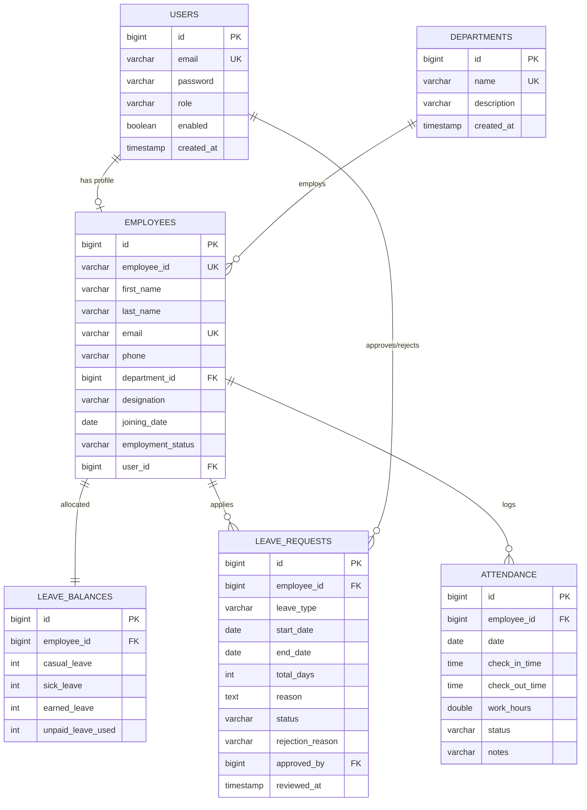

# Enterprise Employee Management & Leave Approval System (EMS)

[](https://www.oracle.com/java/)
[](https://spring.io/projects/spring-boot)
[](https://spring.io/projects/spring-security)
[](https://www.mysql.com/)
[](https://reactjs.org/)
[](https://redux-toolkit.js.org/)
[](https://tailwindcss.com/)
[-success.svg)]()

A full-stack, enterprise-grade **Employee Management and Leave Approval System** engineered using **Java 17 / Spring Boot 3**, **Spring Security with JWT**, **Hibernate / Spring Data JPA**, **MySQL**, **React 18**, **Redux Toolkit**, and **Tailwind CSS**.

Designed for high-performance HR departments, scalable corporate environments, and technical portfolio demonstration at premier technology companies such as **HCLTech**, **Cognizant**, **TCS**, and **Infosys**.

---

## Table of Contents
1. [Architecture & System Design](#1-architecture--system-design)
2. [Database Schema & ER Diagram](#2-database-schema--er-diagram)
3. [Core Capabilities & Business Logic](#3-core-capabilities--business-logic)
4. [Technology Stack](#4-technology-stack)
5. [Project Structure](#5-project-structure)
6. [Getting Started & Local Setup](#6-getting-started--local-setup)
   - [Prerequisites](#prerequisites)
   - [MySQL Database Setup](#mysql-database-setup)
   - [Backend Execution](#backend-execution)
   - [Frontend Execution](#frontend-execution)
7. [Default Seeded Credentials](#7-default-seeded-credentials)
8. [Comprehensive REST API Reference](#8-comprehensive-rest-api-reference)
9. [Automated Testing & QA Verification](#9-automated-testing--qa-verification)
10. [Frontend Pages Overview](#10-frontend-pages-overview)

---

## 1. Architecture & System Design

The application follows a strictly decoupled, layered enterprise architecture:
- **Presentation Layer**: Responsive React 18 Single-Page Application (SPA) driven by Redux Toolkit state slices, React Router 6, Lucide icons, and modern Tailwind CSS.
- **API Gateway & Security Layer**: Stateless JWT authentication filter, role-based authorization via Spring Security 6, and CORS origin policy handling.
- **Controller Layer**: RESTful controllers mapping HTTP requests, handling Bean Validation (`@Valid`), and transforming business responses.
- **Service Layer**: Transactional domain logic (`@Transactional`), business invariant checks (e.g., date overlap detection, working-day holiday calculation, leave quota reconciliation).
- **Persistence Layer**: Spring Data JPA repositories with query methods and custom JPQL filters.
- **Database Layer**: Relational MySQL 8.0 schema featuring foreign key integrity, index optimizations, and unique constraints.

```
+-------------------------------------------------------------------------+
|                              REACT 18 FRONTEND                          |
|  [Redux Toolkit Store] <---> [Axios Client + JWT Interceptor]           |
|  [15 Enterprise UI Pages: Dashboards, Directory, Leaves, Attendance...]  |
+------------------------------------+------------------------------------+
                                     | HTTP / JSON (Bearer JWT)
                                     v
+-------------------------------------------------------------------------+
|                           SPRING BOOT 3 BACKEND                         |
|                                                                         |
|  +-------------------------------------------------------------------+  |
|  | Security Filter Chain: JwtAuthenticationFilter -> SecurityContext |  |
|  +-------------------------------------------------------------------+  |
|                                    |                                    |
|  +---------------------------------+---------------------------------+  |
|  | REST Controllers: Auth, Employee, Leave, Attendance, Department...|  |
|  +---------------------------------+---------------------------------+  |
|                                    |                                    |
|  +---------------------------------+---------------------------------+  |
|  | Service Layer (@Transactional): Business Logic & Validations      |  |
|  +---------------------------------+---------------------------------+  |
|                                    |                                    |
|  +---------------------------------+---------------------------------+  |
|  | Spring Data JPA Repositories & Entity Mappers                     |  |
|  +---------------------------------+---------------------------------+  |
+------------------------------------+------------------------------------+
                                     | JDBC / Hibernate
                                     v
+-------------------------------------------------------------------------+
|                              MYSQL 8.0 DATABASE                         |
|  Tables: users | employees | departments | leave_requests               |
|          leave_balances | attendance                                    |
+-------------------------------------------------------------------------+
```

---

## 2. Database Schema & ER Diagram



---

## 3. Core Capabilities & Business Logic

### A. Role-Based Access Control (RBAC)
- **ROLE_ADMIN**:
  - Full CRUD operations over employees and departments.
  - Organization-wide attendance log with date, status, and department filtering.
  - Review and approve/reject all leave requests.
  - Comprehensive executive metrics on workforce presence and leave queue.
- **ROLE_EMPLOYEE**:
  - Self-service portal to view and update contact profile information.
  - Real-time digital timeclock for daily check-in and check-out.
  - Leave balance tracker (Casual, Sick, Earned, Unpaid).
  - Submit leave requests with automatic working-day calculations.
  - Cancel own pending leave applications.
- **Extensible to ROLE_MANAGER**: Role hierarchy and method-level security (`@PreAuthorize("hasAnyRole('ADMIN', 'MANAGER')")`) allow direct future delegation of approval pipelines.

### B. Enterprise Leave Management Rules
1. **Configurable Weekend Exclusion**: When `app.leave.exclude-weekends=true`, Saturdays and Sundays within the chosen range are excluded from deducted leave days.
2. **Overlap Protection**: Prevents duplicate or overlapping pending/approved leave requests for any employee during the same date interval.
3. **Strict Self-Approval Guard**: An administrator or manager cannot approve or reject their own leave requests (`UnauthorizedException`).
4. **Transactional Leave Balances**: Approval automatically deducts quota from `leave_balances` in an isolated `@Transactional` boundary; rejections never deduct balances.
5. **State Progression**: `PENDING -> APPROVED` or `PENDING -> REJECTED` or `PENDING -> CANCELLED`.

### C. Digital Attendance Clock
1. **Single Workday Punch Guard**: Employees can only create one active check-in session per calendar date (`uk_emp_date` constraint).
2. **Automatic Punctuality Detection**: Check-in after 09:30 AM is automatically tagged as `LATE`.
3. **Work Duration Calculation**: Checkout computes exact fractional hours; sessions under 4.0 hours are recorded as `HALF_DAY`.

---

## 4. Technology Stack

| Layer | Technologies |
|---|---|
| **Backend Framework** | Java 17 LTS / Java 22, Spring Boot 3.3.5 |
| **Security & Auth** | Spring Security 6, JWT (`jjwt` 0.12.6), BCrypt hashing |
| **Persistence & ORM**| Spring Data JPA, Hibernate 6, Bean Validation (Jakarta) |
| **Databases** | MySQL 8.0+ (Production Profile) / H2 (In-memory Test Profile) |
| **Frontend Framework**| React 18.3, JavaScript / ES Modules, Vite 5 |
| **State Management** | Redux Toolkit 2.2, React Redux 9 |
| **Routing & Client** | React Router DOM 6.27, Axios 1.7 |
| **UI & Styling** | Tailwind CSS 3.4, PostCSS, Lucide React Icons |
| **Testing** | JUnit 5, Mockito, Spring Test (`MockMvc`), AssertJ |

---

## 5. Project Structure

```
project1/
├── backend/
│   ├── pom.xml
│   ├── src/
│   │   ├── main/
│   │   │   ├── java/com/ems/
│   │   │   │   ├── EmployeeManagementApplication.java
│   │   │   │   ├── config/              # SecurityConfig, JpaConfig, DataInitializer
│   │   │   │   ├── controller/          # REST Endpoints
│   │   │   │   ├── dto/                 # Request & Response DTOs
│   │   │   │   ├── entity/              # JPA Entities & Enums
│   │   │   │   ├── exception/           # GlobalExceptionHandler & Custom Exceptions
│   │   │   │   ├── mapper/              # Entity to DTO Mappers
│   │   │   │   ├── repository/          # Spring Data JPA Repositories
│   │   │   │   ├── security/            # JWT Token Provider, Filters & UserPrincipal
│   │   │   │   └── service/             # Business Logic & Service Interfaces
│   │   │   └── resources/
│   │   │       ├── application.properties
│   │   │       ├── application-mysql.properties
│   │   │       ├── application-dev.properties
│   │   │       └── schema.sql
│   │   └── test/
│   │       └── java/com/ems/            # 17 Automated Unit & Integration Tests
│   └── target/
├── frontend/
│   ├── package.json
│   ├── vite.config.js
│   ├── tailwind.config.js
│   ├── src/
│   │   ├── api/                         # Axios client & modular API services
│   │   ├── components/
│   │   │   ├── common/                  # Navbar, Sidebar, Modal, Badges, Pagination
│   │   │   └── layout/                  # DashboardLayout
│   │   ├── pages/                       # 15 Required Enterprise UI Pages
│   │   ├── routes/                      # ProtectedRoute & AppRoutes
│   │   ├── store/                       # Redux Toolkit Slices & Store Configuration
│   │   ├── App.jsx
│   │   ├── main.jsx
│   │   └── index.css
│   └── dist/
└── README.md
```

---

## 6. Getting Started & Local Setup

### Prerequisites
- **Java**: JDK 17 or higher (`java -version`)
- **Maven**: 3.8+ or bundled Maven (`mvn -version`)
- **Node.js**: v18+ and npm 9+ (`node -v`, `npm -v`)
- **MySQL**: 8.0 or higher (or use H2 fallback profile)

### MySQL Database Setup
1. Launch MySQL server (via MySQL Workbench, service or CLI).
2. Execute the provided `backend/src/main/resources/schema.sql` or create the database:
   ```sql
   CREATE DATABASE employee_management_db;
   ```
3. Update database credentials in `backend/src/main/resources/application-mysql.properties` if your password differs from `root`:
   ```properties
   spring.datasource.username=root
   spring.datasource.password=YOUR_PASSWORD
   ```

### Backend Execution
To run with MySQL:
```bash
cd backend
mvn spring-boot:run -Dspring-boot.run.profiles=mysql
```

To run with zero-setup development profile (In-memory H2 with MySQL syntax mode):
```bash
cd backend
mvn spring-boot:run
```
The backend initializes on port `8080`.

### Frontend Execution
```bash
cd frontend
npm install
npm run dev
```
Open your browser at `http://localhost:5173`.

---

## 7. Default Seeded Credentials

The database automatically seeds realistic, ready-to-test accounts upon first launch:

| Role | Email | Password | Full Name | Designation & Department |
|---|---|---|---|---|
| **ADMIN** | `admin@ems.com` | `Admin@123` | Sarah Connor | HR Director, Human Resources |
| **EMPLOYEE** | `john.doe@ems.com` | `Emp@123` | John Doe | Senior Java Engineer, Engineering |
| **EMPLOYEE** | `jane.smith@ems.com` | `Emp@123` | Jane Smith | QA Lead Engineer, Quality Assurance |
| **EMPLOYEE** | `robert.brown@ems.com` | `Emp@123` | Robert Brown | Financial Analyst, Finance |

*Tip: The Login page contains one-click buttons to automatically fill demo Admin and Employee credentials!*

---

## 8. Comprehensive REST API Reference

### Authentication Endpoints
- `POST /api/auth/login`: Authenticate email and password, returns Bearer JWT.
- `POST /api/auth/register`: Register new employee account, creates employee & default balance.

### Employee Management
- `GET /api/employees`: Paginated search with department and status filters.
- `GET /api/employees/{id}`: Retrieve employee by ID.
- `GET /api/employees/profile/me`: Retrieve logged-in employee profile.
- `PUT /api/employees/profile/me`: Self-service update for phone and name.
- `POST /api/employees`: (Admin) Create employee with credentials.
- `PUT /api/employees/{id}`: (Admin) Update employee details.
- `PUT /api/employees/{id}/deactivate`: (Admin) Set status to INACTIVE.
- `DELETE /api/employees/{id}`: (Admin) Delete employee.

### Leave Management
- `POST /api/leaves`: Apply for leave (validates balance and overlaps).
- `GET /api/leaves/my`: Retrieve current employee's leave history.
- `GET /api/leaves`: (Admin) Retrieve all leave applications.
- `GET /api/leaves/{id}`: Retrieve leave request details.
- `PUT /api/leaves/{id}/approve`: (Admin) Approve leave and deduct balance.
- `PUT /api/leaves/{id}/reject`: (Admin) Reject leave with mandatory reason.
- `PUT /api/leaves/{id}/cancel`: Cancel pending leave request.
- `GET /api/leaves/balance/my`: Current employee's leave quotas.
- `GET /api/leaves/balance/{employeeId}`: (Admin) Quotas for specific employee.

### Attendance Module
- `POST /api/attendance/check-in`: Punch check-in for current date.
- `POST /api/attendance/check-out`: Punch check-out and compute hours.
- `GET /api/attendance/today`: Check today's punch status.
- `GET /api/attendance/my`: Paginated personal attendance log.
- `GET /api/attendance`: (Admin) Organization-wide attendance log.

### Department & Dashboard
- `GET /api/departments`: List all departments with headcount.
- `POST /api/departments`: (Admin) Create department.
- `PUT /api/departments/{id}`: (Admin) Update department.
- `DELETE /api/departments/{id}`: (Admin) Delete department.
- `GET /api/dashboard/admin`: (Admin) Executive metrics & queues.
- `GET /api/dashboard/employee`: Personal stats, balances & punches.

---

## 9. Automated Testing & QA Verification

All test suites were executed successfully:

```
[INFO] -------------------------------------------------------
[INFO]  T E S T S
[INFO] -------------------------------------------------------
[INFO] Running com.ems.controller.AuthControllerTest
[INFO] Tests run: 2, Failures: 0, Errors: 0, Skipped: 0
[INFO] Running com.ems.service.AttendanceServiceTest
[INFO] Tests run: 3, Failures: 0, Errors: 0, Skipped: 0
[INFO] Running com.ems.service.AuthServiceTest
[INFO] Tests run: 3, Failures: 0, Errors: 0, Skipped: 0
[INFO] Running com.ems.service.EmployeeServiceTest
[INFO] Tests run: 3, Failures: 0, Errors: 0, Skipped: 0
[INFO] Running com.ems.service.LeaveServiceTest
[INFO] Tests run: 6, Failures: 0, Errors: 0, Skipped: 0
[INFO] 
[INFO] Results:
[INFO] Tests run: 17, Failures: 0, Errors: 0, Skipped: 0
[INFO] BUILD SUCCESS
```

To re-run tests locally:
```bash
cd backend
mvn test
```

---

## 10. Frontend Pages Overview

The frontend includes 15 distinct, responsive views:

1. **Login Page (`/login`)**: Enterprise card, credentials toggle, one-click demo logins.
2. **Registration Page (`/register`)**: Employee registration with department assignment.
3. **Admin Dashboard (`/admin/dashboard`)**: KPI metrics, quick approval queue, live punch stream.
4. **Employee Dashboard (`/dashboard`)**: Personal greeting, digital timeclock, quota cards.
5. **Employee Directory (`/employees`)**: Search by name/ID, department & status filters, pagination.
6. **Employee Details (`/employees/:id`)**: Comprehensive profile and leave balance report.
7. **Add/Edit Employee (`/employees/new`, `/employees/:id/edit`)**: Admin form with client validation.
8. **Leave Application Form (`/leaves/apply`)**: Live working-day preview, balance guards.
9. **Leave Approval Management (`/admin/leaves`)**: Filter tabs, rejection reasoning dialog.
10. **Leave History (`/leaves/history`)**: Filterable personal leave timeline with cancel action.
11. **Attendance Management (`/attendance`)**: Dual tab: personal timecard vs admin master log.
12. **Department Hub (`/departments`)**: Visual cards with employee headcounts and CRUD modals.
13. **Employee Profile (`/profile`)**: Self-service editable contact info + company records.
14. **Access Denied Page (`/access-denied`)**: 403 Forbidden with navigation back to allowed home.
15. **Not Found Page (`/404`)**: 404 Route handling with return button.

---

## License
Developed as an enterprise portfolio implementation. Free to use for technical interviews and reference.

